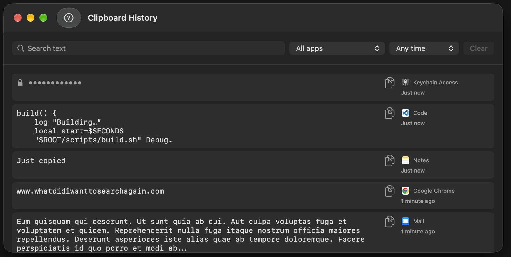

# Cliphoard

A macOS menu bar app that keeps a searchable history of everything you copy.
Only text is recorded; images, files and other clipboard types are ignored.

The history is stored locally in SQLite at
`~/Library/Application Support/dev.local.Cliphoard/history.sqlite`, readable only by your user.



## Secrets

Passwords and tokens are hidden in the list, left out of searches and stored
encrypted. Showing or copying one asks for Touch ID or your password, then stays
unlocked for 5 minutes or until the screen locks.

An item is a secret when the password manager marks it as concealed
([nspasteboard.org](http://nspasteboard.org)), when it was copied from a password
manager, or when it looks like a password (can be turned off in Settings). Items
the password manager marks as transient aren't stored at all. Right-click an item,
or use the lock button on its detail page, to mark or unmark it yourself.

The encryption key is in your login keychain. This is not the highest possible security with the secure enclave. But since secure enclave is only available with a team signed app which in turn requires a developer account I leave it like that for now.

## Settings

Open with ⌘, or from the menu bar icon.

- **Maximum items**: how many items to keep (default 10,000). The oldest are deleted when the limit is reached.
- **Secrets**: whether to detect passwords and tokens by their content (on by default).
- **Global shortcut**: brings Cliphoard to the front from any app. Off by default; when enabled it defaults to ⌘⇧C and can be changed.

## Keyboard shortcuts

| Where  | Keys                    | Action                          |
| ------ | ----------------------- | ------------------------------- |
| List   | ↓ or j                  | Next item                       |
|        | ↑ or k                  | Previous item                   |
|        | → or l or ↩             | Open item                       |
|        | c                       | Copy item                       |
|        | esc                     | Clear selection                 |
|        | / or a letter or number | Search <br>(j, k, l and c don't start a search; type / first.)|
| Search | ⇥                       | Go to the first result          |
|        | ⇧⇥ (from the list)      | Back to search                  |
| Detail | ← or h                  | Back to the list                |
|        | c                       | Copy item                       |
| App    | ⌘,                      | Settings                        |


## Install

With Homebrew:

```sh
brew install --cask jonasheinrich/tap/cliphoard
```

Or download the DMG from the [latest release](https://github.com/jonasheinrich/Cliphoard/releases/latest)
and drag Cliphoard to Applications.

Cliphoard isn't notarized by Apple yet, so macOS blocks its first launch. Open
System Settings > Privacy & Security and click "Open Anyway". This is needed
once per installed version.

## Build from source

Requires macOS 15 and Xcode (the full app, not only the Command Line Tools).

```sh
git clone git@github.com:jonasheinrich/Cliphoard.git
cd Cliphoard
make install
```

This builds a release version, copies it to `/Applications` (set `INSTALL_DIR` to
change that) and launches it. On first launch it adds itself as a login item;
turn that off in the menu bar menu. To update, run `git pull && make install`.

Each build has a new local signature, so after an update macOS asks once whether
Cliphoard may use its keychain key; choose "Always Allow".

`make uninstall` removes the app and its login item, and prints how to delete the
history and settings as well.

## Development

| Command      | What it does                                                  |
| ------------ | ------------------------------------------------------------- |
| `make build` | Release build into `build/`                                   |
| `make run`   | Debug build, launched once                                    |
| `make dev`   | Debug build that rebuilds and relaunches on every change (`scripts/dev.sh`) |
| `make clean` | Delete `build/`                                               |

`make dev` keeps running until Ctrl-C and launches the app in the background.
With `fswatch` installed (`brew install fswatch`) it reacts to changes instantly
instead of polling.

## Releasing

1. Set the version (`MARKETING_VERSION`) in the Xcode project and commit.
2. `scripts/release.sh` builds `build/Cliphoard-<version>.dmg` and the Homebrew
   cask `build/cliphoard.rb`. Try the DMG.
3. `scripts/release.sh --publish` additionally tags `v<version>`, pushes the tag
   and creates the GitHub release with the DMG. The GitHub cli `gh` is needed for that. Install with `brew install gh` and run `gh auth login`.
4. Copy `build/cliphoard.rb` to `Casks/cliphoard.rb` in
   [jonasheinrich/homebrew-tap](https://github.com/jonasheinrich/homebrew-tap) and push.

With an Apple developer account, set `DEVELOPER_ID` and `NOTARY_PROFILE` (see the
top of `scripts/release.sh`) to sign and notarize; the cask then drops the
"Open Anyway" note.

## Product Questions
- Typing a letter goes to search but j etc does not. Is that bad UX/confusing?
- When copying an item from clipboard:
    - Add a new entry? Currently nothing is added.
    - If yes: Show as copied from clipboard?
- Also store rich Text Format and pictures?

## Later
- Store on what device something was copied and send it to some cloud to share it.
- Refactor. I think Claude left a bit of a mess in some places. Probably visual and business logic could be separated for instance.
- Tests. And Linters.
- With a developer account:
    - Team sign it with a better app id.
    - Use Secure Enclave for the secret key that encodes the passwords.
- From-to filtering for time.
- Regex filter for text.

## Note

Developed using Claude Code without specs or tests. Looked a bit into the code but didn't bother too much. Just a small fun project. :)